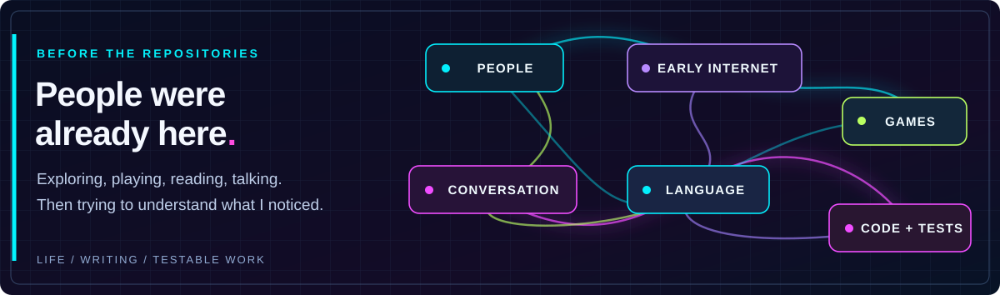

Hi, I'm James.

I like being with my family, being outside, playing games, and learning what other people are interested in. I can spend a long time watching how someone does something, especially when they really care about it. I like getting another perspective. Sometimes that's a conversation; sometimes it's reading something someone wrote or playing alongside them.

The research grew out of questions I've had for a long time. I'm interested in what changes when people misunderstand each other, what stays the same when the description changes, and what I can actually demonstrate with mathematics or software.

**[Research source](https://github.com/huntingthereferent/autobots-assemble)** · **[About the investigation](RESEARCH.md)** · **[All projects](showcase/PROJECT_INVENTORY.md)** · **[Writing](writing/README.md)**

## The person behind the projects

Before I had repositories, I was the kid spending hours looking through the grass for little animals, collecting diaries, and building a GeoCities page for graffiti from around the world. Later I spent years around Quake III and World of Warcraft, watching other players, learning the games, and meeting people I wanted to keep playing with.

Those weren't research projects. That's just what I was doing.

I still like ordinary life. I haven't stopped being the person who enjoys his family or who wants to see what another person is doing. The subjects have expanded, and now some of the questions have source code, proofs, experiments, and records attached to them.

[**Childhood and the Early Internet →**](writing/CHILDHOOD.md) · [**World of Warcraft and Reckful →**](writing/CHILDHOOD_PART_TWO.md) · [**Origin of the investigation →**](writing/ORIGIN.md)

## What I'm investigating

Some of the observations are about the world around me; some are about my own experience of moving through it. I don't want an explanation to replace the thing I'm actually trying to describe. If you misunderstand me, or I misunderstand you, I want to keep what happened in that exchange. The correction can tell me something the polished version doesn't.

I use AI to help explore descriptions, make programs, and prepare writing. It's a tool and another perspective, not the source of every question. What I personally observed, what we inferred together, and what an independent test can establish are different records.

| | |
| :--- | :--- |
|  |  |
|  |  |
|  |  |

## Follow the actual work

Different questions need different evidence. A description that fits one conversation doesn't automatically prove something in a game. A successful game replay doesn't prove a general solver. And a source file isn't the same as a verified deployment.

| Inquiry | Where to go |
| :--- | :--- |
| **Language and observation** | [Language Referent](https://github.com/huntingthereferent/autobots-assemble/blob/main/LANGUAGE_REFERENT.md) · [Language and Observation](writing/LANGUAGE_AND_OBSERVATION.md) · [Human Drift](https://github.com/huntingthereferent/autobots-assemble/blob/main/language/HUMAN_DRIFT.md) |
| **Finite mathematics** | [Constructed models and cases](showcase/MATHEMATICS.md) · [Conjugacy work](docs/FINITE_STATE_CONJUGACY.md) |
| **Games and interactive worlds** | [ARC evidence and limitations](ARC_EVIDENCE.md) · [Native observations](https://github.com/huntingthereferent/autobots-assemble/tree/main/research/arc_native_runs) |
| **Workstation and software** | [Workers, handoffs, verification](https://github.com/huntingthereferent/autobots-assemble/blob/main/systems/workspace/WORKSTATION.md) · [Selected software](SELECTED_WORK.md) |
| **Source-linked public data** | [Observation view](https://github.com/huntingthereferent/autobots-assemble/blob/main/views/world-continuity/LATEST.md) · [Public data code](https://github.com/huntingthereferent/autobots-assemble/blob/main/work/projects/public-data-monitor/README.md) |

[**Project inventory →**](showcase/PROJECT_INVENTORY.md) · [**Research overview →**](RESEARCH.md) · [**Evidence and provenance →**](PROVENANCE.md)

## Writing and the people in it

I have trouble writing a finished account of myself in isolation. I get more from another person's perspective, including when we get something wrong and have to work it out. I want both sides of those conversations preserved, not just an assistant's polished interpretation afterward.

[**Origin of the Investigation**](writing/ORIGIN.md) · [**Childhood and the Early Internet**](writing/CHILDHOOD.md) · [**World of Warcraft and Reckful**](writing/CHILDHOOD_PART_TWO.md) · [**Language and Observation**](writing/LANGUAGE_AND_OBSERVATION.md) · [**Watching What Continues**](writing/WATCHING_WHAT_CONTINUES_2026-10-17.md)

[**Read all the writing →**](writing/README.md) · [**Original quotations →**](writing/LANGUAGE_AND_OBSERVATION_QUOTES.md)

---

Independent, human-directed inquiry with AI-assisted coding and writing. Tests, source, interpretations and open questions remain distinguishable.
