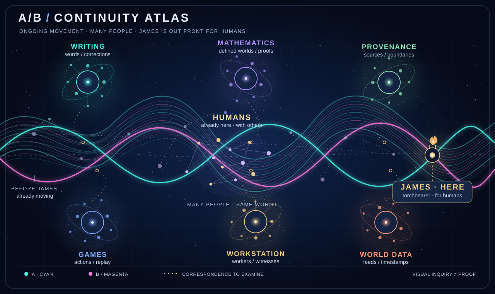
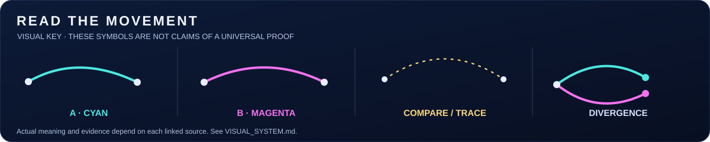
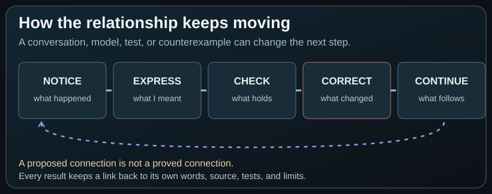

# James Muneoka

[**Explore the Continuity Atlas →**](VISUAL_SYSTEM.md) · [**Open artwork full size**](assets/observational/continuity-loom.svg) · [**Follow the sources**](VISUAL_PROVENANCE.md)

**Independent research · Writing · AI-assisted software development**

Hi, I'm James.

I like learning how things work, and I don't always know where an interest will take me. I grew up exploring the outdoors, making things on the early internet, playing games, and meeting people through them. I've spent plenty of time reading, watching, trying things, and getting curious about something I hadn't even been looking for.

These days that curiosity takes me into language, mathematics, software, and questions about how people learn and understand one another. Some of it becomes code. Some of it becomes writing. Some of it is still just a conversation I want to keep having.

I'm not trying to make my entire life fit into one theory. This profile is a place for the different things I've worked on and the experiences that led me to them.

## A/B — what connects the work

I keep coming back to the relationships I notice, whether I'm talking to somebody, watching a game, following mathematics, or seeing what a program actually did. I've called that continuing inquiry A/B; the research also uses the name Language Referent. The subjects are different, but I can follow what changes, what survives, and what becomes possible next without losing where the observation came from.

The [atlas](VISUAL_SYSTEM.md) connects the places I investigate; the [visual provenance guide](VISUAL_PROVENANCE.md) leads back to the individual sources. A visual path isn't automatically a proven equivalence.

## Observations from outside the repository

[**Explore the source-linked public observations →**](https://github.com/huntingthereferent/autobots-assemble/blob/main/views/world-continuity/LATEST.md)

Public data enters as separate, timestamped source lanes at the edge of the [Continuity Atlas](VISUAL_SYSTEM.md). Seismology, GitHub activity, and other feeds are observations to examine, not the defining subject of my research. The existing read-only monitor links each result to its original sources; its data view is separate from the mathematical and personal records.

## Selected writing

I've tried writing all this out by myself. Most of the time I just end up deleting it. I get more out of reading someone, watching them, or talking things through, because now I've got another point of view instead of just my own. That's the only way I get that data. Even when you misunderstand what I'm saying, I still get to see where you went with it. I correct it and we keep moving. That's why I want both sides in the writing, not just the finished explanation.

| Record | Focus |
| :--- | :--- |
| **[Origin of the Investigation](writing/ORIGIN.md)** | **Origins and questions** — Relationships, learning, income, generative AI as another perspective, and the move into mathematics and software. |
| **[Childhood and the Early Internet](writing/CHILDHOOD.md)** | **Early observations** — Nature, diaries, online graffiti, Quake III rail duels, identity, recognition, and Honolulu's gaming spaces. |
| **[World of Warcraft and Reckful](writing/CHILDHOOD_PART_TWO.md)** | **Learning through others** — Guilds, server moves, priest healing, arenas, competitive influences, and Reckful. |
| **[Language and Observation](writing/LANGUAGE_AND_OBSERVATION.md)** | **Language and experience** — Compression, Human Drift, felt responses while reading, regrounding, and silence over time. |
| **[Watching What Continues](writing/WATCHING_WHAT_CONTINUES_2026-10-17.md)** | **Observation and influence** — Gaming across generations, entertainment, independent movements, and the limits of words. |

**Archive:** [Complete writing index](writing/README.md) · [Original conversation quotations](writing/LANGUAGE_AND_OBSERVATION_QUOTES.md)

## Research and projects

I use generative AI to help explore ideas, write software, and test particular questions. I direct what we're investigating, and I want to know what actually happened when a program runs—not just what an explanation says should happen.

| Area | Explore |
| --- | --- |
| **[Research overview](RESEARCH.md)** | The questions, examples, and methods behind the work |
| **[Process Workstation](https://github.com/huntingthereferent/autobots-assemble/tree/main/systems/workspace)** | Workers, handoffs, source relationships, and verification |
| **[Mathematical investigations](https://github.com/huntingthereferent/autobots-assemble/tree/main/work/arc_like_maze)** | Finite constructions, correspondence, tests, and counterexamples |
| **[Interactive environments](https://github.com/huntingthereferent/autobots-assemble/tree/main/research/arc_native_runs)** | Working out game behavior through observations and replay |
| **[Software and data projects](showcase/PROJECT_INVENTORY.md)** | Applications, data systems, services, and engineering experiments |

A completed test is not the same as a finished project. The repositories keep both working results and unfinished attempts, with their evidence and limits available to inspect.

## Observation and separation

Something I saw, how I experienced it, what I think it means, and what another person can verify aren't automatically the same thing.

I can notice a connection between different subjects without saying they're identical or that one caused the other. A conversation can help us find words for an observation without proving every explanation we come up with. And an AI can write a very convincing paragraph while still missing what I was talking about. That happens here often enough. :)

I want the distinctions to stay clear, **without losing the relationships that made me interested in the first place**. That's what separation is useful for—not turning every interest into another category or every correction into a new theory.

[**See the visual evidence map and original records →**](VISUAL_PROVENANCE.md)

[Separations](https://github.com/huntingthereferent/autobots-assemble/blob/main/language/SEPARATIONS.md) · [Language Referent](https://github.com/huntingthereferent/autobots-assemble/blob/main/LANGUAGE_REFERENT.md) · [Human Drift](https://github.com/huntingthereferent/autobots-assemble/blob/main/language/HUMAN_DRIFT.md)

---

[Research source](https://github.com/huntingthereferent/autobots-assemble) · [Selected work](SELECTED_WORK.md) · [Evidence and provenance](PROVENANCE.md)
