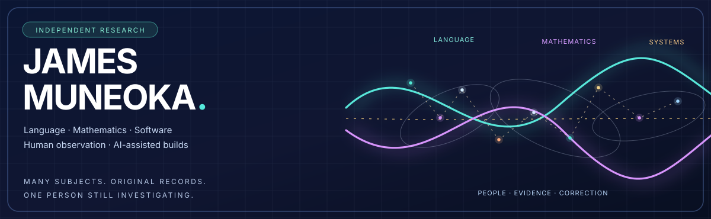
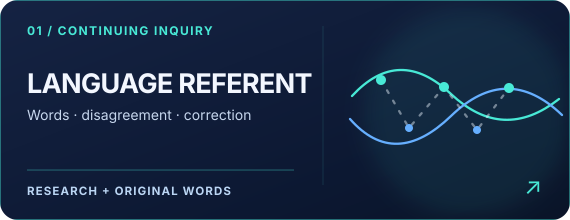
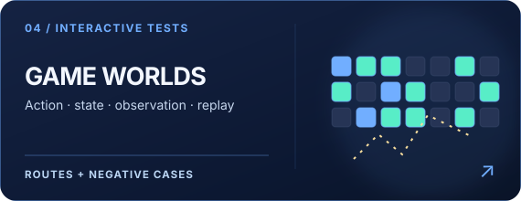
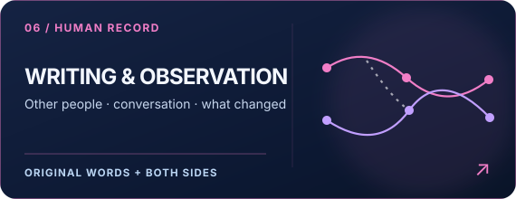

# James Muneoka

Hi, I'm James. I like learning how things work, and I don't always know where an interest will take me. I grew up exploring the outdoors, making things on the early internet, playing games, and meeting people through them.

These days I follow questions through language, mathematics, software, games, and conversations. Some turn into working code. Some turn into writing. Some are still questions worth investigating. I'm not trying to make my entire life fit into one theory.

**I'm literally FOR HUMANS.** I don't investigate people from outside the picture. Talking with someone, seeing their perspective, and correcting what I misunderstood are part of what makes the work move.

**[Explore the research source →](https://github.com/huntingthereferent/autobots-assemble)** · **[All projects →](showcase/PROJECT_INVENTORY.md)** · **[Evidence & limitations →](PROVENANCE.md)**

---

## Featured work

Six ways into the same person's work. Each one has its own source, methods, tests, and open questions.

| | |
| :--- | :--- |
|  |  |
|  |  |
|  |  |

**Go deeper:** [Research overview](RESEARCH.md) · [Math cases](showcase/MATHEMATICS.md) · [Source inventory](showcase/PROJECT_INVENTORY.md) · [Selected engineering work](SELECTED_WORK.md)

## Evidence you can inspect

I use generative AI to help write, formalize, build, and test. I direct the questions and corrections. A public file, a reported local result, a passing test, and independent reproduction are different kinds of evidence.

| Work | Public entry | What the record supports |
| :--- | :--- | :--- |
| **W12–W13 game and receipt work** | [W13 independent verdict](https://github.com/huntingthereferent/autobots-assemble/blob/main/systems/workspace/WITNESS_W13_INDEPENDENT_VERDICT.md) · [W12 recovery](https://github.com/huntingthereferent/autobots-assemble/blob/main/systems/workspace/W12_SOURCE_RESTORATION.md) | A bounded, separately checked local browser/game path; not a public deployment or general autonomy claim |
| **Finite transformation systems** | [Mathematical work](showcase/MATHEMATICS.md) · [Conjugacy case](docs/FINITE_STATE_CONJUGACY.md) | Declared state spaces, operators, counterexamples, and scoped witnesses; no universal theorem inferred |
| **Process Workstation** | [Source and status](https://github.com/huntingthereferent/autobots-assemble/blob/main/systems/workspace/WORKSTATION.md) · [Evidence index](PROVENANCE.md) | Versioned handoffs, workers, independent checks, and unresolved boundaries; not a self-running distributed service |
| **Source-linked public data** | [Current observation view](https://github.com/huntingthereferent/autobots-assemble/blob/main/views/world-continuity/LATEST.md) · [Data platform](https://github.com/huntingthereferent/autobots-assemble/blob/main/work/projects/public-data-monitor/README.md) | Separate external sources with recorded timestamps, rather than an invented connection between unrelated feeds |

The [complete project inventory](showcase/PROJECT_INVENTORY.md) includes education, security, applied ML, networking, embedded systems, and other experiments. A working artifact doesn't mean an entire project is finished; the [provenance record](PROVENANCE.md) keeps those distinctions visible.

## One inquiry, many layers

[**Explore the full atlas and movement key →**](VISUAL_SYSTEM.md) · [**Follow original sources →**](VISUAL_PROVENANCE.md)

I call the continuing inquiry **Language Referent**; A/B is its earlier name and still names operations inside some finite mathematical models. I can notice relationships across contexts without claiming that the contexts are identical or that one mathematical result proves another.

The paths in the artwork are a way to move between subjects. **They do not make James the origin of humanity or of the movement.** Other people are already part of the picture. The mathematics gets its meaning from the specific world and evidence it belongs to.

## Writing and people

I've tried writing all this out by myself. Most of the time I just end up deleting it. I get more out of reading someone, watching them, or talking things through, because now I've got another point of view instead of just my own. That's the only way I get that data. Even when you misunderstand what I'm saying, I still get to see where you went with it. I correct it and we keep moving. That's why I want both sides in the writing, not just the finished explanation.

| Reading | Where it goes |
| :--- | :--- |
| [**Origin of the Investigation**](writing/ORIGIN.md) | How conversations led toward mathematics, programming, and testing |
| [**Childhood and the Early Internet**](writing/CHILDHOOD.md) · [**World of Warcraft and Reckful**](writing/CHILDHOOD_PART_TWO.md) | Early gaming, people, recognition, and observation |
| [**Language and Observation**](writing/LANGUAGE_AND_OBSERVATION.md) | Reading, drift, misunderstandings, feeling, and correction |
| [**Watching What Continues**](writing/WATCHING_WHAT_CONTINUES_2026-10-17.md) | Influence, other people, and the limits of an explanation |

**[All writing →](writing/README.md)** · [Original conversation quotations](writing/LANGUAGE_AND_OBSERVATION_QUOTES.md)

## How to read the work

Something I saw, how I experienced it, what I think it means, and what someone else can verify aren't automatically the same thing. I want those differences preserved without losing the relationship that made me interested.

[**Evidence & provenance**](PROVENANCE.md) · [**Language Referent**](https://github.com/huntingthereferent/autobots-assemble/blob/main/LANGUAGE_REFERENT.md) · [**Separation**](https://github.com/huntingthereferent/autobots-assemble/blob/main/language/SEPARATIONS.md) · [**Human Drift**](https://github.com/huntingthereferent/autobots-assemble/blob/main/language/HUMAN_DRIFT.md)

---

Human-directed inquiry, AI-assisted implementation and writing. Public records show what can be inspected; unresolved questions remain open.
